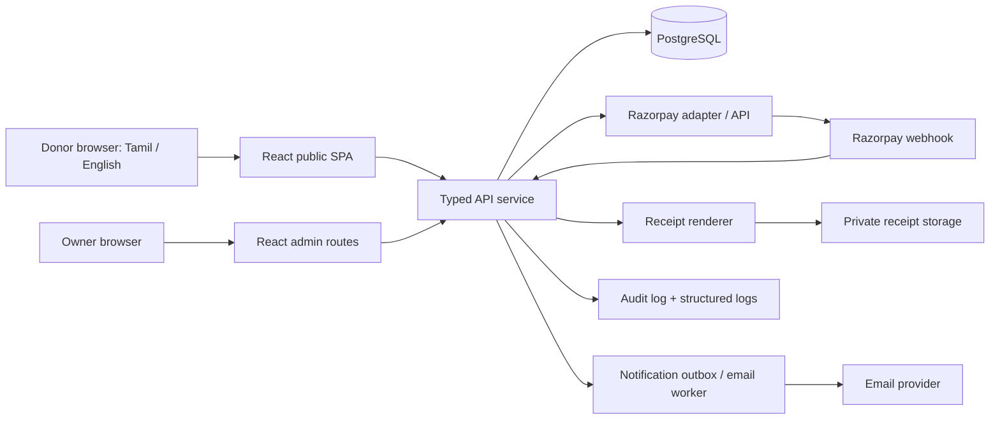
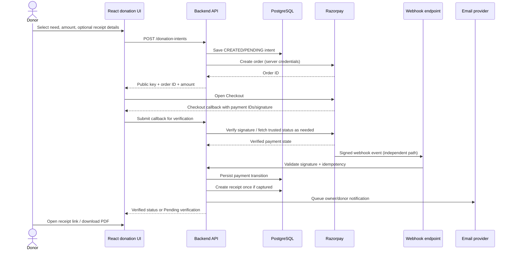

# Charitable Trust Donation Website — Product, UX & Engineering Master Plan

**Planning baseline:** 28 October 2026  
**Primary build environment:** Claude Desktop → **Code** tab  
**Frontend:** React + TypeScript + Vite  
**Product shape:** Public bilingual single-page website + private owner dashboard + separately deployable API/payment service  
**Payment provider for launch:** Razorpay, subject to merchant account approval and enabled payment methods

> This is an implementation specification, not a claim that the trust is legally eligible for any particular tax benefit or payment method. Replace all `[CONFIRM]` values with verified trust documents and current provider settings before launch. Do not invent trust registrations, statistics, beneficiary stories, project costs, testimonials, or impact figures.

## 1. Executive direction

Build a small, credible, mobile-first charity website that helps a visitor answer four questions quickly:

1. **Who is the trust and can I verify it?**
2. **What does it do for teenagers and families who need support?**
3. **How will my donation be used and how can I follow the outcome?**
4. **Can I pay safely, receive a proper acknowledgement, and reach the trust if something goes wrong?**

The launch version is not a crowdfunding marketplace. It is a trust-owned website with a simple owner dashboard. A future donation/payment website should be possible without rewriting the public website. Keep the public UI, business API, database and payment provider behind clear boundaries from day one.

### Non-negotiable product decisions

- The public trust website is one long landing page with anchor navigation. Keep `/donate`, `/receipt/:token`, and `/admin/*` as focused utility routes where needed; they are not additional marketing pages.
- Tamil and English must have equivalent meaning and equivalent access to the donation flow, trust disclosures, contact details and policies.
- Donation status, receipt creation, receipt number assignment and owner notifications are backend-owned.
- The browser redirect and a QR scan are **not** proof of successful payment.
- A donation receipt is an acknowledgement, not automatically a tax certificate or GST invoice.
- The website may only show real impact statistics and verified legal details supplied by the trust.
- Protect beneficiary dignity: use images, names, case studies and family details only with documented, appropriate consent. Do not expose minors' personal details or exact locations unnecessarily.
- Every implementation task must state its scope, preserve existing behavior, run relevant checks, and return an auditable file-change summary.

## 2. Research benchmark and opportunity gaps

This is a category benchmark of representative Indian donation experiences, not a claim that any named site is deficient. No specific trust domain or design reference was supplied, so do not describe this as an audit of the trust's existing website.

| Reference | Public pattern observed in available official material | Pattern to borrow for this trust |
|---|---|---|
| [Give.do](https://give.do/?hl=en-IN) | Organizes giving around causes and ongoing missions; describes official acknowledgements and campaign updates. | Make the needs understandable, offer a clear way to donate to a selected area, and send a meaningful acknowledgement/update. |
| [Milaap verification policy](https://crowdfunding.milaap.org/milaap-trust-verification-policy/) | Describes NGO verification, regular campaign updates, donor-data handling and fraud-reporting expectations. | Display verifiable trust information, explain how updates are maintained, provide a contact/reporting path, and state how donor data is handled. |
| [Akshaya Patra financial reports](https://www.akshayapatra.org/financial-reports) | Publishes annual reports and financial/audit/evaluation materials. | Give the owner a simple way to publish dated financial and governing documents, rather than hiding transparency behind marketing language. |
| [CRY financials](https://www.cry.org/financials/) and [impact](https://www.cry.org/our-impact/) | Presents financial disclosures alongside impact measures and program outcomes. | Explain outcomes with dated, sourced metrics and separate financial information from emotional storytelling. |

### The trust-specific gaps this design should close (validate each against the actual trust)

1. **Proof-of-trust gap:** visitors cannot quickly find the trust's legal name, registration particulars, office/contact details, named governing information where appropriate, verified payment beneficiary name, and published documents.
2. **Donation-to-need gap:** a donor cannot tell what kind of need they are supporting or how unrestricted donations are allocated.
3. **Payment-status gap:** donors pay by QR or leave the checkout page but do not know whether the trust has received a verified payment.
4. **Receipt gap:** a donor must message the owner manually to request a donation acknowledgement; the owner must manually find, generate and send it.
5. **Owner-operations gap:** donation records, receipts, payment exceptions and campaign updates are spread across provider dashboards, emails and spreadsheets.
6. **Transparency-update gap:** there is no repeatable place to publish dated updates, approved budget/use-of-funds summaries and financial documents.
7. **Language gap:** Tamil content is incomplete or materially different from English content, or the language switch resets the user's donation selection.
8. **Privacy/safeguarding gap:** donor information is over-collected or shared in public receipt links, or beneficiary stories are published without consent controls.
9. **Change-control gap:** small code edits unintentionally break mobile layout, translated strings, payment status handling, SEO or accessible navigation.

These are requirements to test, not assumptions about current practice. If a capability already exists, preserve it and document the evidence.

## 3. Audience and primary journeys

### Audiences

- **First-time donor:** needs a fast trust check, a clear area of need, a simple secure payment route and confirmation.
- **Repeat donor:** wants to donate again without re-learning the site and may want a receipt link.
- **Family/community supporter:** wants a simple URL to share with family groups and community networks.
- **Trust owner/operator:** needs to reconcile money received, resolve pending payments, send receipts, post updates and export records without technical knowledge.
- **Person requesting support:** needs to understand the trust's scope and contact/process for requesting help. Do not imply that a public donation form is an application for aid.

### Public donor journey

`Landing page → Need area → Donate amount → Optional receipt details → Razorpay checkout / supported QR → Server verification → Receipt link + email acknowledgement → Share or return`

### Support-request journey

`Landing page → “Request support” / “Need help?” → Scope and eligibility explanation → Minimal contact form or phone/WhatsApp contact → Privacy notice → Owner follow-up`

Do not collect sensitive financial/medical/family data in the first contact form. If the trust needs evidence later, collect it through a separate, access-controlled process the trust has approved.

## 4. Public one-page information architecture

Recommended order below follows user intent rather than a generic marketing template.

### 4.1 Header and navigation

- Trust logo and actual legal/operating name.
- Anchors: About, Areas of Support, Impact, Transparency, Contact.
- Language switch: தமிழ் / English, keyboard accessible and clearly selected.
- Primary CTA: Donate.
- Mobile: compact header with visible Donate action; menu button has an accessible name and does not cover the whole page unexpectedly.

### 4.2 Hero: mission + one clear action

- Human, specific headline about supporting teenagers/young people and their families.
- One short paragraph describing the trust's actual scope.
- Primary CTA: Donate to a Need.
- Secondary CTA: See Our Work / Verify the Trust.
- Use a real, approved image where possible; otherwise use a respectful typographic/illustrative hero. Avoid stock photography that implies a real beneficiary or fabricated AI-generated people presented as trust beneficiaries.
- Never invent urgency, a beneficiary count, a fundraising deadline or a matching-donation claim.

### 4.3 Trust facts strip

Show only facts that have been provided and verified, such as registered name, registration identifier, operating area, established year, current tax-approval status only if evidence confirms it under the applicable law (legacy documents may refer to 80G), and a contact channel. Hide unknown fields instead of showing placeholders publicly.

### 4.4 Areas of support / needs

Possible categories (final list must be agreed with the trust):

- Education and learning support.
- Skills, training and career readiness.
- Emergency family support.
- Nutrition, health access or essential needs, if this is within the trust's actual objects and delivery capability.
- Other trust-approved initiatives.

Each card should provide: purpose, who it is for, example of eligible support (not a promise), whether donations are earmarked or general, dated progress/update if available, and a CTA that passes the selected `programId` into the donation form. If the owner cannot substantiate separate accounting per program, label donations as general support rather than implying ring-fenced funds.

### 4.5 How a donation helps

Use a small set of examples only when the trust can verify costs and their context. Example labels must be marked as illustrative if exact cost coverage varies. Do not imply that a ₹500 gift automatically buys a specific item unless the trust can deliver that promise. Explain whether administrative costs are included and how unallocated funds are handled.

### 4.6 How the process works

A simple three/four-step explanation: select a need → choose amount → pay through the payment provider → receive acknowledgement and later updates. Include a link to payment help/refund/correction policy.

### 4.7 Impact and stories

- Metrics require a source, measurement period, owner and last-updated date in the admin CMS.
- A metric without a source/date is not publishable.
- Stories use consented media and text. For minors, require appropriate guardian/organizational consent, and prefer anonymous or non-identifying stories.
- Do not show exact home locations, school details or sensitive personal information for vulnerable beneficiaries.
- Empty state: replace the section with a factual statement about current activities instead of zeroes or fabricated statistics.

### 4.8 Transparency centre

A compact, mobile-friendly list of downloadable/linked documents:

- Trust registration proof or official particulars that the trust authorizes to publish.
- Current tax-exemption approval evidence, only if applicable and current.
- Annual report, audit report, financial summary or utilization report when available.
- Donation allocation/financial reporting policy.
- Child/beneficiary safeguarding policy and privacy policy where appropriate.

Each record includes document title, language, reporting period/date, version or uploaded date, and file type. Only publish documents approved by the trust; redact personal data and bank information not intended for public disclosure.

### 4.9 Frequently asked questions

Minimum topics: how a donation is used; whether a donation is earmarked; payment pending/failed; receipt timing; tax deduction eligibility; how to request support; how donor information is used; how to report a concern; how to contact the owner.

The tax answer must reflect the actual current status of the trust and must not make an unconditional promise. If the trust is not confirmed as eligible, say so plainly.

### 4.10 Contact and help

- Verified phone, email, address/area, hours if confirmed.
- Request Support CTA and Donate CTA should be visually different.
- Form includes server-side validation, anti-spam protection, consent notice, success/error states and an alternative contact method.

### 4.11 Footer

Trust legal name and verified particulars, contact, language switch, privacy policy, terms, donation/refund policy, receipt help, transparency documents and copyright year. Add social accounts only if genuinely owned and maintained by the trust.

## 5. UX behavior and visual system

### Visual direction

Aim for warm, calm, credible and locally grounded—not an AI template. Establish a visual system based on the trust's actual identity. The palette below is a placeholder direction only, not a final brand decision:

- Warm off-white background with a dark readable text colour.
- One primary trust colour and one accent for donation actions.
- Neutral surfaces and restrained borders.
- A single display typeface paired with a highly legible Tamil-compatible body typeface. Confirm glyph coverage and test Tamil line wrapping before locking fonts.
- Consistent spacing, radii, shadows, icon style and button heights.
- Use motion only for small transitions and respect `prefers-reduced-motion`.
- Do not use glassmorphism, excessive gradients, floating cards on every section, oversized stock imagery or decorative charts that do not convey verified information.

### Responsive breakpoints and test viewports

Use content-driven breakpoints, not device-brand assumptions. At minimum compare and test:

- Mobile: 360 × 800 and 390 × 844.
- Tablet: 768 × 1024.
- Desktop: 1366 × 768 and 1440 × 900.

Check header wrapping, Tamil text height, CTA visibility, donation modal/section fit, QR readability, tables, receipt page, admin navigation, loading/error/empty states and footer overflow.

### Accessibility baseline

Target WCAG 2.2 AA as the practical baseline: semantic landmarks, correct heading order, visible keyboard focus, keyboard-operable controls, labels and useful validation messages, sufficient contrast, accessible dialog focus management, alt text for meaningful images, captions/transcripts for video, reduced-motion support and no colour-only payment status. Include manual keyboard and screen-reader spot checks; an automated scan alone is not certification.

## 6. Donation form and payment architecture

### Preferred user experience

1. Donor chooses a need (or general donation), amount and whether to remain anonymous in public impact lists (if a donor wall is ever added).
2. Donor optionally supplies name/email/mobile. Request PAN/address only if the trust's confirmed receipt/tax process genuinely requires it; make the purpose clear before collection.
3. Backend validates the amount, currency, selected program, consent and rate limits.
4. Backend creates the donation intent and Razorpay order using server-only credentials.
5. Frontend opens Razorpay Checkout. Use UPI/cards/netbanking only if enabled and approved for the trust's account. If Razorpay's supported checkout flow displays a UPI QR for the order, use that rather than a hand-built image.
6. Frontend callback posts the payment identifiers/signature to the backend.
7. Backend verifies the Razorpay signature and checks the order/payment state against a trusted Razorpay API response as needed.
8. Razorpay webhook is independently validated using the provider's documented webhook-signature process. Persist the webhook event id and make processing idempotent.
9. Only a verified captured payment transitions the donation to `PAID`; then create the receipt once and queue notifications.
10. Show a success page with receipt link only after verified status. Otherwise show `Pending verification` with a way to re-check status; never show a false success page.

Razorpay documents server-side checkout signature verification and recommends webhooks as the primary automation channel, supplemented by API verification for immediate user-facing status. Its security checklist also calls for webhook HMAC validation. See the official links in §16.

### QR strategy: choose explicitly before implementation

**Preferred:** order-linked Razorpay Checkout with UPI available, including a provider-rendered QR when the enabled checkout flow offers it. This allows the site to associate the payment with its donation intent.

**Alternative:** use Razorpay QR Codes API only after confirming that the trust's account has the required feature and the chosen QR lifecycle can be associated with a donation reference and reconciled automatically. Test captured, failed, duplicate and refunded QR payments.

**Fallback only:** a static UPI QR that sends money directly to a UPI ID. Treat it as **manual reconciliation** unless the payment is imported/verified against a reliable provider or bank record. Display instructions to submit the UTR/reference and explain that a receipt is issued after verification. The UTR supplied by the donor is not proof by itself. Never let a screenshot or form submission set `PAID`.

### Payment state model

- `CREATED` — intent saved, order not yet completed.
- `PENDING` — checkout/QR payment initiated; awaiting confirmation.
- `AUTHORIZED` — provider authorized but not yet captured, if this state appears in the provider lifecycle.
- `PAID` — verified captured payment.
- `FAILED` — verified failure or provider-reported terminal failure.
- `REFUND_PENDING` / `REFUNDED` — refund workflow and provider confirmation.
- `MANUAL_REVIEW` — mismatch, duplicate, late or unlinked payment requiring owner review.

Store provider status separately from the trust's normalized status. Store amounts as integer paise, not floating-point rupees. Use immutable provider payment/order IDs and unique constraints to prevent duplicate records.

### Receipt and share-link behavior

- Create a server-assigned, unique receipt number only once a verified payment is recorded.
- Generate an acknowledgement PDF using a versioned template with the trust's verified legal name and contact, receipt number, date, amount, purpose/general-fund designation, payment reference (masked if needed), and acknowledgement wording.
- Add tax-deduction language only when the trust's eligibility and current process have been verified. An instant donation acknowledgement is not the same as a statutory donation certificate under the current Income-tax Act, 2025 workflow.
- Generate an unguessable random receipt token; store a hash of it where feasible. Do not put email, phone, PAN or donor name in the URL.
- The share view displays only minimum required fields. Do not expose PAN, full address, email, phone, or other sensitive data on a public link.
- Give the donor Download PDF and Copy/Share Link actions.
- On receipt creation, queue an email to the configured trust owner with receipt ID, amount, selected program, verified payment reference and receipt link. Send a donor email only when a valid email was supplied and the notice/consent wording permits it.
- Email delivery failure must not undo a paid donation; keep the notification retryable and show delivery state in the dashboard.
- Acknowledgements should not be issued for a pending/failed payment. For refunds, keep the original record and add a refund/correction record; never silently delete the receipt or payment history. If the trust is eligible and needs statutory donation certificates, maintain a separate status such as `NOT_APPLICABLE`, `PENDING_TRUST_FILING`, `FORM_113_FILED`, `FORM_114_ISSUED`, or `CORRECTION_REQUIRED`; do not claim the website generated the statutory certificate unless an officially supported, authorized integration exists.

### Important legal/accounting gate

Important current-law update (checked 28 October 2026): India's Income-tax Act, 2025 came into force on 1 April 2026. The donation-deduction provision corresponding to legacy Section 80G is Section 133 under the new Act. The Income Tax Department's current e-filing materials map legacy Forms 10BD/10BE to Forms 113/114 under the 2025 Act; eligible entities submit the donation statement in Form 113, and the statutory Form 114 donation certificate is generated through the official e-filing workflow. Build two separate concepts: (a) the website's instant payment acknowledgement PDF, and (b) a statutory tax donation certificate tracked in the trust's compliance process. Do not label the site-generated PDF as Form 114, promise a tax deduction, or automatically imply eligibility. Have the trust's accountant/legal adviser confirm its current approval, applicable section, transition status, required donor fields and the current reporting workflow. Similarly, keep foreign/international donations disabled for launch until the trust's FCRA position, bank account and gateway approval are verified. FCRA treatment can depend on donor/source facts; the site should not try to infer this from nationality text alone.

## 7. Owner dashboard modules

Use a private route group (`/admin/*`) in the same frontend initially, with a visually separate admin shell. The API remains separately deployable so the dashboard can later move to another domain/app without changing donation business rules.

### 7.1 Overview

- Verified donations today, current month and lifetime.
- Count of captured payments, pending verification, failed payments and refunds.
- Net donation total calculation clearly documented; show gross captured and refunds separately so they cannot be confused.
- Recent activity and unresolved exceptions.
- Do not claim settlement/bank balance from captured payments; provider capture and bank settlement are different measures.

### 7.2 Donations ledger

- Search by receipt/reference/provider ID; filter by date, program, normalized status, amount, payment method and receipt state.
- Detail view shows donation intent, provider order/payment IDs, state transitions, webhook event history, receipt and notification status.
- CSV export with explicit timestamp/timezone and filters applied. Exclude secrets and hide/mask unnecessary personal data.
- No edit-in-place for payment amount/status. Correct mistakes via an audited adjustment/refund/reconciliation workflow.

### 7.3 Payment exceptions / reconciliation

- Pending older than a configurable interval.
- Provider success but webhook/receipt processing pending.
- Amount/order mismatch, duplicate event, refund, unknown/manual QR payment.
- Each action requires a reason and writes an audit log entry. Manual marking as paid must require provider/bank evidence and a second confirmation; ideally keep it limited to owner role.

### 7.4 Receipts and notifications

- Browse receipt list, copy share link, download PDF, re-send email, view status/errors.
- Receipt reissue creates a new version/audit entry rather than deleting original evidence.

### 7.5 Needs/programmes and content

- Create/update/pause a support area, its bilingual title/body, CTA, allocation disclaimer and optional public progress goal.
- Manage public sections, FAQ, impact measures, story approvals, document uploads and last-updated date.
- Preview Tamil/English before publish. Public stats and legal-status claims should require explicit owner review.

### 7.6 Transparency documents

- Upload approved documents, choose language and reporting period, add title/summary and publication date.
- Validate file type/size on client and server; never allow executable uploads; store outside the web root or in controlled object storage.
- Document removal must create an audit event and preserve policy-required archival copies where applicable.

### 7.7 Settings and audit log

- Trust profile, official email, payment-provider public key/config status (never display the secret), receipt template, support contact, language defaults and notification preferences.
- Append-only audit log: actor, action, entity, record ID, timestamp, reason, changed fields (sensitive values redacted), request/correlation ID.
- Owner-only access at launch. Add distinct staff roles only when a real operational need exists.

## 8. Recommended technical architecture

### Stack

- **Frontend:** React + TypeScript + Vite + React Router; CSS Modules or a small token-based CSS system. Keep dependencies lean. Use a single established UI primitive library only if it demonstrably improves accessibility; do not install a component library just to fill space.
- **Data fetching/forms:** a small typed API client; React Hook Form + Zod or equivalent where useful. Validate again on the server—client validation is UX, not security.
- **Backend:** a separate Node.js + TypeScript API (Fastify or Express; pick one and standardize). Keep Razorpay SDK calls inside the server/payment adapter.
- **Database (primary):** Neon managed PostgreSQL. **Fallback:** Supabase-hosted PostgreSQL. Use a typed ORM with versioned migrations (default recommendation: Prisma ORM, with the PostgreSQL driver adapter where supported) and keep the schema portable to standard PostgreSQL. Use Neon pooled `DATABASE_URL` for app runtime and direct/unpooled `DIRECT_URL` for migrations/admin tools. Pin the ORM version and follow its matching current setup docs; do not mix configuration examples across major versions. For Supabase, select a supported direct or session-mode pooler URL based on runtime/network needs, and use a migration connection supported by the selected ORM. Avoid Supabase-only auth, storage, client SDK, or RLS dependencies unless the owner explicitly approves accepting that migration coupling. All secrets and database access remain server-only; never connect directly from the browser.
- **Auth:** server-validated admin session in HttpOnly, Secure, SameSite cookie; hashed passwords or a trusted identity provider. Require strong owner authentication and MFA if the chosen auth/provider supports it.
- **Email:** provider adapter for owner and donor notification, configured by environment variables. No secret in `VITE_*` or public config.
- **Storage:** private object storage for PDFs and internal documents; public-only approved transparency documents can use a separate public path/bucket.
- **Testing:** Vitest + React Testing Library for UI/domain units; API integration tests; Playwright for browser flows, responsive screenshots and accessible-role checks.
- **Observability:** structured server logs, correlation IDs, error monitoring and a basic webhook event/retry view. Never log secrets, PAN, payment signatures or full personal data.

React's current docs recommend starting with a framework for many new full React apps, while also documenting Vite as a valid way to build from scratch when constraints justify it. Here, the deliberate choice is a Vite SPA plus a separately deployable API: the public scope is a one-page website and the API/payment logic must be migratable independently. Revisit SSR/prerendering if the site grows into a large SEO-driven content library.

### Separation rule

The frontend should know only `VITE_API_BASE_URL` and the Razorpay public key returned/approved for client use. The backend owns authentication, amounts, orders, payment verification, receipts, email delivery, secrets and database access. Implement a `PaymentProvider` interface with a `RazorpayProvider` implementation so replacing or adding a provider later does not require rewiring the donation form or dashboard domain logic.

### Architecture graph



### Database provider decision and portability contract

**Decision:** start with Neon PostgreSQL; keep Supabase PostgreSQL as the fallback. The project must not rely on Neon-only SQL extensions or Supabase-only application services for core donation behavior. Both providers are treated as PostgreSQL hosts—not as interchangeable application frameworks.

**Connection contract**

- `DATABASE_URL`: runtime connection string. For Neon, use the pooled connection string for the selected project/branch.
- `DIRECT_URL`: unpooled/direct connection for schema migrations, introspection, backup and restore tooling where supported. For Supabase fallback, use a direct connection when the runtime/network supports it, or a suitable session-mode pooler; do not assume a transaction-mode pooler supports migration tooling.
- Never commit either value. Keep actual URLs in local ignored environment files and the deployment secret manager. Provide only empty placeholders in `.env.example`.
- Pin the Prisma ORM major version in the lockfile. At implementation time, check the current official Prisma + Neon and Prisma + Supabase docs and use the matching `prisma.config.ts` / driver-adapter setup. Prefer a standard PostgreSQL driver adapter rather than a provider-specific app client if it is supported by the chosen runtime. Do not copy config snippets from a different Prisma major version.
- Database access stays in the backend `db` module and domain repositories/services. Feature modules must not read environment variables or instantiate database clients directly. Frontend packages must not import Prisma, `pg`, Neon or Supabase server SDKs.
- Use PostgreSQL-standard data types, constraints, indexes, transactions and migrations. Keep payment state transitions and idempotency in backend domain logic and DB constraints. Do not use a spreadsheet as the source of truth.
- Keep storage, authentication, email, and payment integrations behind separate interfaces; neither Neon nor Supabase should become the identity provider or receipt storage by accident.

**Fallback/switch procedure**

1. Confirm why the switch is needed and whether this is development data or live donor/payment data. Obtain explicit approval before changing production configuration or moving live data.
2. Verify the current schema and migration history, confirm both providers support the required PostgreSQL features, and create a restorable backup from the source using a direct/unpooled connection.
3. Provision the destination, apply the same versioned migrations, and restore data if needed. Do not assume changing `DATABASE_URL` moves existing records.
4. For a live cutover, schedule a maintenance window, pause new donation intents, keep webhook events retryable, complete a final consistent backup/restore, then switch secrets and deploy. Never acknowledge a webhook as processed before its event is durably recorded. Reconcile pending/recent orders against Razorpay before reopening donations.
5. Validate row counts, foreign-key constraints, unique receipt/payment references, indexes, admin access, reports and migration status. Run API/integration/E2E tests and a sandbox payment smoke test.
6. Keep the source database intact and read-only for the agreed rollback window. Define a rollback decision point; avoid split-brain writes to both databases. If the destination has accepted production writes, plan reverse reconciliation before rolling back.
7. Record the reason, timestamp, operator, migration evidence, test results and rollback outcome in a dated architecture decision record.

A provider switch during development with disposable test data may be as small as provisioning the new database, applying migrations and replacing environment variables. Once real donations exist, this is a data migration and cutover—not merely a connection-string edit.

**Current documentation to consult at implementation time:** [Neon connection guide](https://neon.com/docs/get-started/connect-neon), [Neon + Prisma guide](https://neon.com/docs/guides/prisma), and [Supabase PostgreSQL connection guide](https://supabase.com/docs/guides/database/connecting-to-postgres). Vendor limits and connection behavior can change; verify them before deployment.

### Donation sequence graph



## 9. Repository and module tree

This is a target tree; do not create all files empty at the start. Add each module when its contract and acceptance tests are ready.

```text
trust-donation-platform/
├── CLAUDE.md
├── PROJECT_SPEC.md
├── README.md
├── .env.example
├── .gitignore
├── package.json
├── pnpm-workspace.yaml                 # only if using workspaces
├── apps/
│   ├── web/                             # public site + admin route group
│   │   ├── index.html
│   │   ├── vite.config.ts
│   │   ├── src/
│   │   │   ├── app/                     # router, app providers, error boundaries
│   │   │   ├── routes/
│   │   │   │   ├── public-home/
│   │   │   │   ├── donate/
│   │   │   │   ├── receipt/
│   │   │   │   └── admin/
│   │   │   │       ├── login/
│   │   │   │       ├── overview/
│   │   │   │       ├── donations/
│   │   │   │       ├── receipts/
│   │   │   │       ├── programmes/
│   │   │   │       ├── transparency/
│   │   │   │       └── settings/
│   │   │   ├── features/
│   │   │   │   ├── donation/             # form, hooks, schemas, state mapping
│   │   │   │   ├── payment/              # checkout client only; no secret logic
│   │   │   │   ├── receipts/             # receipt view/share actions
│   │   │   │   ├── admin-auth/
│   │   │   │   ├── dashboard/
│   │   │   │   └── content-management/
│   │   │   ├── components/
│   │   │   │   ├── ui/                  # reusable buttons, dialogs, fields, badges
│   │   │   │   ├── layout/              # public shell and admin shell
│   │   │   │   └── feedback/            # loading, empty, error, success states
│   │   │   ├── i18n/                    # en and ta dictionaries, locale utilities
│   │   │   ├── lib/                     # API client, formatters, accessibility helpers
│   │   │   ├── styles/                  # tokens, reset, global styles
│   │   │   └── test/                    # test setup and shared fixtures
│   │   └── e2e/                         # Playwright public/admin/payment tests
│   └── api/
│       ├── src/
│       │   ├── app.ts                   # server assembly and plugin registration
│       │   ├── config/                  # env parsing and safe startup checks
│       │   ├── modules/
│       │   │   ├── auth/
│       │   │   ├── donation-intents/
│       │   │   ├── payments/
│       │   │   ├── webhooks/
│       │   │   ├── receipts/
│       │   │   ├── programmes/
│       │   │   ├── public-content/
│       │   │   ├── transparency-documents/
│       │   │   ├── notifications/
│       │   │   └── audit-log/
│       │   ├── providers/
│       │   │   ├── payments/            # interface + razorpay adapter
│       │   │   ├── email/               # interface + configured adapter
│       │   │   └── storage/
│       │   ├── db/                      # ORM client, migrations, transactions
│       │   ├── middleware/              # auth, rate limits, request IDs, errors
│       │   ├── jobs/                    # retryable notification/outbox processing
│       │   └── tests/
│       └── prisma/                      # schema and versioned migrations
├── packages/
│   ├── contracts/                      # shared API DTOs and status enums only
│   ├── validation/                     # shared safe schemas when genuinely shared
│   └── test-fixtures/                  # non-production test records
├── docs/
│   ├── ux-spec.md
│   ├── api-contracts.md
│   ├── payment-state-machine.md
│   ├── data-dictionary.md
│   ├── threat-model.md
│   ├── release-checklist.md
│   ├── database-provider-switch.md     # Neon primary, Supabase fallback runbook
│   └── decisions/                      # dated ADRs for architecture changes
├── scripts/
│   ├── check-env.mjs
│   └── verify-release.mjs
└── .claude/
    ├── settings.json
    ├── rules/
    │   ├── ui-ux.md
    │   ├── payments-security.md
    │   ├── database-api.md
    │   └── privacy-i18n.md
    ├── agents/
    │   ├── change-auditor.md
    │   ├── payment-security-reviewer.md
    │   ├── ui-regression-reviewer.md
    │   └── accessibility-i18n-reviewer.md
    ├── skills/
    │   ├── implementation-task/SKILL.md
    │   ├── change-audit/SKILL.md
    │   ├── payment-flow/SKILL.md
    │   ├── visual-review/SKILL.md
    │   └── release-gate/SKILL.md
    └── scripts/
        └── post-edit-audit.mjs
```

### Module boundaries

- `features/donation` owns donor-facing form state and validation; it does not make payment-authority decisions.
- `features/payment` starts checkout and reports callback data to the API; it does not mark records paid.
- `modules/payments` owns the payment provider interface, state transitions and trusted API calls.
- `modules/webhooks` validates signatures, stores event IDs, deduplicates, and invokes the same payment transition service used by callback verification.
- `modules/receipts` generates the receipt only from a verified paid record and enforces uniqueness.
- `modules/audit-log` records sensitive admin actions; the payment handler should not be coupled to UI code.
- `packages/contracts` contains DTOs, not database credentials, payment secrets or server-only models.

## 10. Data model (minimum viable)

Use UUIDs or equivalent opaque IDs for internal records; do not expose sequential database IDs in public links.

| Entity | Main fields / notes |
|---|---|
| `admin_users` | `id`, identity/email, auth-provider ID or password hash, role, active flag, last login, created/updated timestamps. Avoid custom password storage if a suitable managed identity provider is available. |
| `programmes` | `id`, slug, bilingual title/description, donation designation (`GENERAL` or `RESTRICTED` only with genuine accounting capability), active status, sort order. |
| `donation_intents` | `id`, public reference, programme ID nullable for general donation, amount paise, currency, donor fields minimized, acknowledgement preference, normalized status, created/updated timestamps. |
| `payment_attempts` | intent ID, provider, provider order ID, provider payment ID nullable until available, provider status, amount paise, method, captured/refunded values, signature-verified timestamp, unique provider identifiers. |
| `webhook_events` | provider event ID unique, event type, received timestamp, signature valid flag, processing status/error; avoid storing secrets or unnecessary raw payload. If raw payload is retained for audit/replay, define access and retention. |
| `receipts` | intent/payment ID with unique constraint, acknowledgement number unique, template version, token hash, storage key, issued timestamp, correction/reissue links. |
| `tax_certificate_tracking` (feature-gated) | Donation/receipt reference, applicable tax-law workflow, reporting tax year, Form 113 filing status/reference, Form 114 issue date/reference, correction status and accountant/owner audit trail. Do not store portal credentials; never mark a statutory certificate issued without actual evidence. |
| `notification_outbox` | event type, destination reference, template/language, retry count, next attempt, sent/failed timestamps; do not store full sensitive payload when a lookup can be used. |
| `content_sections` | section key, localized content, draft/published status, version, author/editor, updated date. |
| `impact_metrics` | localized label, numeric/value format, source/evidence link, period, approved/published flags, updated date. |
| `transparency_documents` | title, language, reporting period, storage key, file type/size, publication state, approved by/date, upload timestamp. |
| `audit_logs` | actor ID, action, entity type/ID, timestamp, reason, before/after changed field names with sensitive values redacted, correlation ID. Append-only to normal admin code. |

**Do not store:** card numbers, UPI PINs, internet-banking credentials, payment passwords, full payment instrument data, donor documents that the trust has no established reason/authority to collect, or secrets in the database. Store payment-provider IDs and the minimum records required for reconciliation.

## 11. API contract outline

Version the API from the beginning (`/api/v1`). Validate input and output contracts; return stable error codes and correlation IDs.

### Public endpoints

- `GET /api/v1/public/site-content?locale=ta|en`
- `GET /api/v1/public/programmes?locale=ta|en`
- `GET /api/v1/public/transparency-documents?locale=ta|en`
- `POST /api/v1/donation-intents` — server validates amount, currency, programme and consent; creates provider order or a controlled pending QR/manual-review record.
- `POST /api/v1/payments/verify` — accepts order/payment IDs and signature, verifies server-side.
- `GET /api/v1/donations/status/:publicReference` — returns only donor-safe status fields; rate limit and avoid personal-data disclosure.
- `GET /api/v1/receipts/:token` — returns minimal receipt view or signed download URL after token validation.
- `POST /api/v1/support-requests` — minimal data and server-side spam protection.
- `POST /api/v1/contact` — optional, only if an independent contact form is needed.

### Provider webhook

- `POST /api/v1/webhooks/razorpay` — preserve the raw request body as required for provider signature validation; verify signature before processing; record event ID; return the provider-required success response promptly; process idempotently. Confirm exact event configuration against the trust's Razorpay dashboard.

### Admin endpoints (session required)

- `POST /api/v1/admin/auth/login`, `POST /api/v1/admin/auth/logout`, `GET /api/v1/admin/auth/session`
- `GET /api/v1/admin/overview`
- `GET /api/v1/admin/donations` with pagination, filters and sort whitelist
- `GET /api/v1/admin/donations/:id`
- `GET /api/v1/admin/receipts`, `POST /api/v1/admin/receipts/:id/resend`
- `GET /api/v1/admin/reconciliation/exceptions`, `POST /api/v1/admin/reconciliation/:id/resolve`
- CRUD/publish endpoints for programmes, FAQ/content, impact metrics and transparency documents
- `GET /api/v1/admin/audit-logs`
- `GET/PATCH /api/v1/admin/settings` with secret write-only behavior; never return the provider secret

### API rules

- Amount is created/validated server side; never accept a trusted final amount from a success callback.
- Apply rate limits to login, donation creation, status lookups and forms.
- Paginate all admin list endpoints; enforce maximum page sizes and an allowlist for sort fields.
- Use parameterized queries/ORM safely; reject unknown fields rather than mass-assigning request bodies.
- Return generic public error messages. Record technical details in private structured logs with personal data redacted.

## 12. Security, privacy and compliance gates

Before live payments:

- Razorpay merchant account and the trust's approved business profile are active; the trust has confirmed which payment methods and QR capabilities are enabled.
- API key ID is only used in the frontend where expected; API key secret and webhook secret are backend-only environment variables. `.env*` secrets are never committed; `.env.example` contains placeholders only.
- Verify checkout signatures on the backend and webhook signatures using the documented mechanism; use constant-time comparison where appropriate.
- Webhook processing is idempotent; duplicate and out-of-order events cannot create duplicate receipts or roll a paid record backward incorrectly.
- Verify payment amount, currency, order ID and captured/refund state against trusted provider data.
- Require HTTPS; secure cookies; CSRF protection where cookie-authenticated state-changing requests need it; CORS allowlist; content security policy where practical; login rate limit; secure session expiration; least privilege; backups and restore test.
- Restrict admin routes on the API—not only in React UI. Publicly hiding a button is not access control.
- Uploaded documents are type/size checked server-side and stored safely. Public content needs a publish/approval state.
- Privacy notice states purposes, required/optional data, communication usage, retention/contact path and the trust's actual data practices. Minimize collected data and restrict access.
- Make owner notification email configurable and verified; avoid sending PAN/full contact data in owner notification if it is not needed.
- Confirm data-protection obligations and the phased application of applicable Indian law/rules with qualified counsel; do not improvise legal claims in the UI.
- At launch, default to domestic INR donations; international payments must remain disabled until the trust confirms applicable FCRA/legal/bank/gateway requirements.

## 13. Code-change audit harness for Claude Desktop

Use Claude Desktop's **Code** tab with the actual repository opened. Start meaningful work in Plan mode/read-only inspection, then approve a narrowly scoped plan. Desktop documentation describes automatic verification of edits, including browser screenshots/error checks, and supports subagents; coordinated Agent Teams are CLI-only, so this plan does not depend on them.

### Root `CLAUDE.md` should require

1. Read `PROJECT_SPEC.md`, relevant rules, current Git status and existing tests before editing.
2. Never overwrite project files wholesale when a focused patch is possible.
3. Explain intended files and acceptance tests before broad refactors or database changes.
4. Never invent facts, API behavior, legal status or unverified UI content. Stop and request a human decision when trust/legal/payment facts are missing.
5. Never edit `.env`, live secrets, provider dashboard settings, production data, or irreversible migrations without explicit owner approval.
6. Implement one vertical slice at a time, keeping public and admin experiences working.
7. After each task, report files added/changed/deleted, behavior changed, tests run, test results, screenshots/views checked, assumptions and remaining risks.
8. Do not claim a check passed unless the command or test was actually run successfully.

### Reviewer agents

Run the appropriate read-only reviewer after implementation; the main session remains responsible for fixes and acceptance. Recommended reviewers:

- **Change auditor:** examines the Git diff and touched call paths for unintended behavior, dead code, scope creep and incomplete deletions.
- **Payment/security reviewer:** traces donation intent → order → callback → webhook → status → receipt; looks for client-trusted status, signature omissions, duplicate events, amount mismatch, secret exposure and privacy leaks.
- **UI regression reviewer:** compares the current UI against approved reference screenshots at mobile/tablet/desktop and checks loading, error, empty and long-Tamil-text states.
- **Accessibility/i18n reviewer:** checks keyboard operation, semantic labels, focus, contrast, screen-reader names, Tamil/English parity and clipping.

Agents review evidence and return findings by severity. They must not modify code unless the task explicitly delegates a fix to them. If a critical or high finding remains unresolved, do not ship.

### Skills / repeatable workflows

- `/implementation-task`: inspect → plan → implement a small scoped change → test affected behavior → summarize changed files.
- `/change-audit`: read `git status`, `git diff --name-status`, `git diff --check` and the full patch; trace imports/references/tests; identify missed additions, edits and removals.
- `/payment-flow`: inspect all payment-state transitions, server-side signature verification, webhook idempotency, amounts/refunds, receipt uniqueness and secret boundaries.
- `/visual-review`: run app, compare screenshots to baseline across specified viewports and languages, inspect console/network errors, report layout/behavior differences.
- `/release-gate`: run all required tests, review diff and dependency changes, verify environment variables and migrations, then produce a release report.

### Automated change audit and human gate

- A `PostToolUse` hook may run after Claude's `Edit`/`Write` operations to run a lightweight `git diff --check` and surface the changed-file list. This is feedback, not proof that the application works. Shell commands or external tools can modify/delete files without triggering the same hook, so always run the final Git diff audit.
- After any feature task, the final gate runs lint, typecheck, unit tests, API integration tests, end-to-end critical journey tests and visual checks that are available in the repository.
- Deletions get special review: search references, imports, routes, CSS classes, translation keys, API contracts, migrations and tests. Never delete a failing test simply to make the suite green; replace/update it only with a justified behavior change.
- Preserve screenshots as versioned baselines; update a baseline only after deliberate design approval, never merely to silence a visual diff.
- Use Git branches or a worktree for risky changes, review the diff in Claude Desktop, and commit only after the user approves the resulting behavior.

### Practical task cycle

1. **Baseline:** `git status --short`; confirm the app's current state and known failing tests.
2. **Plan:** list acceptance criteria, touched modules, API/data changes, risk, and tests. No edits yet.
3. **Implement:** change the smallest coherent set of files; use existing tokens/components and patterns.
4. **Verify:** relevant unit/integration/e2e tests, browser console, accessible names, responsive screenshot, Tamil and English.
5. **Independent review:** call the relevant read-only reviewer(s).
6. **Reconcile:** fix findings, rerun failed checks; classify any blocked check with a reason.
7. **Diff audit:** `git diff --check`, `git diff --stat`, `git diff --name-status`, inspect the full diff and removed code references.
8. **Deliver:** summarize changed files, behavior, tests/results, screenshot evidence, DB migration/release steps, assumptions, unresolved risks and rollback plan.

## 14. Implementation phases and gates

### Phase 0 — Confirm facts and freeze scope

Collect the trust's exact legal name, language preference, logo/brand assets, trust registration details, official contact/address, service regions, verified mission, approved real photographs, bank beneficiary name, current tax approvals (if any), payment account status, receipt wording, owner notification email and privacy/contact policy. Decide whether the website only receives donations or also takes support requests. Document unresolved facts as blockers rather than creating fake values.

**Gate:** signed-off content inventory and legal/payment checklist; no production code assumed complete.

### Phase 1 — UX and design system

Create section order, low-fidelity wireframes, responsive layouts, a small token system, Tamil typography tests, component states and approved desktop/mobile references. Test donation CTA and support CTA with a small walkthrough.

**Gate:** approve hero, donation panel, trust facts, transparency section, footer, language toggle and admin shell before detailed polish.

### Phase 2 — Public website skeleton

Implement route structure, bilingual content data, shared components, responsive layout, static transparent content and accessible navigation. Use verified copy and hide unconfirmed sections. Add page title/meta, social metadata and performance basics.

**Gate:** mobile/tablet/desktop checks in both languages; all links and CTA destinations work; no placeholder facts presented as real.

### Phase 3 — Backend foundation and admin authentication

Set up database/migrations, environment validation, API contract, auth/session, audit logging, public content endpoints and a protected admin shell. Seed only synthetic test data in development.

**Gate:** unauthorized API access denied; Neon development database configured using pooled runtime and direct migration URLs; migration tested from a clean database; portability check documents the Supabase connection/config steps; no secrets in bundle or repository.

### Phase 4 — Donation and Razorpay sandbox

Implement donation intent, server-side amount validation, Razorpay order creation, checkout callback verification, webhook signature verification, event deduplication, normalized state model and provider test mode. Add pending/failed/refunded/manual-review UI states.

**Gate:** test success, cancel, failure, duplicate webhook, webhook delay, amount mismatch, signature mismatch and refresh/back-button behavior. Do not use live keys.

### Phase 5 — Receipts and owner notifications

Generate receipt only after verified capture, create safe share link, PDF download, owner notification and retryable outbox. Build receipt list/re-send tools in admin.

**Gate:** exactly one receipt per payment; notifications can retry without creating duplicate receipts; public link does not leak PII; PDF wording approved by trust/accountant.

### Phase 6 — Owner operations

Build overview, donation ledger, filters, records, reconciliation exceptions, CSV export, programmes/content, transparency upload, settings and audit log. Keep admin interactions simple and task-focused.

**Gate:** owner can locate a donation, tell its real provider state, download/copy receipt link, export selected records and review exceptions with no database access.

### Phase 7 — Hardening and launch

Run full test matrix, accessibility review, responsive visual regression, dependency/secrets scan, backup/restore validation, error monitoring and production webhook test. Confirm payment account, mail DNS/settings, legal pages, real copy, and production rollback procedure.

**Gate:** all critical checks pass or are explicitly accepted in writing by the trust owner; no unresolved critical/high payment/security/accessibility defect.

## 15. Definition of done / acceptance tests

### Public experience

- [ ] First-time visitor understands mission, trust identity and how to donate without scrolling through irrelevant text.
- [ ] Tamil and English have equivalent section coverage, meaning and working links.
- [ ] Donation amount and programme selection persist when the user changes language or returns from a failed/cancelled checkout where feasible.
- [ ] Empty/loading/error states are designed; no broken images, hidden CTA, horizontal overflow or console error in test viewports.
- [ ] Support request is distinct from donation and collects only approved minimum data.

### Payment and receipt

- [ ] Amount is validated and order created on the server.
- [ ] Fake callback/signature cannot mark donation paid.
- [ ] Invalid webhook signature is rejected and does not change payment state.
- [ ] Duplicate/out-of-order webhook and repeated callback do not duplicate a payment or receipt.
- [ ] Provider success with delayed webhook remains pending until verified; UI can re-check status safely.
- [ ] Amount/currency/order mismatch becomes an exception, not `PAID`.
- [ ] Receipt exists only after verified captured payment; exactly one receipt number per payment.
- [ ] Refunds/corrections retain original evidence and produce an audited state update.
- [ ] Owner email is sent/retryable; email failure cannot undo a verified payment.
- [ ] Public receipt link contains no PII in URL and no PAN/full contact data in public HTML/PDF preview.
- [ ] Static/manual QR cannot be auto-confirmed from a donor-uploaded screenshot or self-entered UTR.

### Dashboard/security

- [ ] Anonymous user cannot access admin API endpoints.
- [ ] All admin mutations require authentication, validation and audit logging.
- [ ] Secrets are absent from Git, compiled JS, API responses and logs.
- [ ] File uploads are validated; exports follow privacy minimization; list APIs paginate.
- [ ] Restore process is tested; error logs and webhook exceptions are actionable.
- [ ] Neon uses pooled runtime and direct migration connections; provider configuration is server-only and documented.
- [ ] Core schema and queries avoid provider-specific features that would make the Supabase PostgreSQL fallback require a domain rewrite.

### Code and design audit

- [ ] `git diff --check` clean; lint and typecheck pass.
- [ ] Unit, API integration and E2E tests pass, including critical payment paths.
- [ ] Visual baselines checked at required widths and in both languages.
- [ ] Changed and deleted code is reviewed for stale imports, routes, translations, tests and API contracts.
- [ ] Reviewer findings are closed or explicitly risk-accepted.
- [ ] Final implementation summary states exactly what was tested and what was not.

## 16. Decisions that must be escalated instead of guessed

Pause the affected work and ask the owner/developer to resolve when any of these is unclear:

- Trust's legal name, registration, current tax-approval status under the applicable Income-tax Act/Rules (including transition from legacy 80G terminology), or authority to accept a category of donation.
- Whether a program is restricted/earmarked and the trust's actual allocation/accounting policy.
- Whether donor PAN/address is required for the selected receipt/tax process.
- Whether international donations are permitted and what bank account/gateway setup applies.
- Which Razorpay QR feature is enabled and whether it can be linked/reconciled to individual donation intents.
- The approved beneficiary image/story and consent basis, especially for minors.
- Whether owner email, bank/settlement information or donor contact data is approved for a particular view/export.
- Any request to bypass signature/webhook verification, manually fake paid status, suppress audit logs, expose secrets or delete payment history.
- A migration that can destroy production data, a bulk deletion, or a UI change that removes an established user journey without a replacement.

When escalation occurs: stop the uncertain part, retain verified work, write the exact blocker and alternatives, and continue only with independent tasks. Do not fill the gap with invented assumptions.

## 17. Current references checked for this plan

These links are references for implementation decisions, not legal advice. Re-check provider docs and requirements when starting implementation because features and rules can change.

1. Give.do, giving/cause organization and donation acknowledgement/update patterns: https://give.do/?hl=en-IN
2. Milaap trust and verification policy: https://crowdfunding.milaap.org/milaap-trust-verification-policy/
3. Akshaya Patra financial reports: https://www.akshayapatra.org/financial-reports
4. CRY financials: https://www.cry.org/financials/
5. CRY impact: https://www.cry.org/our-impact/
6. Razorpay server integration and signature verification: https://razorpay.com/docs/payments/server-integration/python/integration-steps
7. Razorpay security checklist: https://razorpay.com/security/checklist/
8. Razorpay QR Codes API, fetch payments: https://razorpay.com/docs/api/qr-codes/gst/fetch-payments/?preferred-country=IN
9. Ministry of Finance / PIB, Income-tax Act, 2025 effective from 1 April 2026: https://www.pib.gov.in/PressReleasePage.aspx?PRID=2248005&lang=1
10. Income Tax Department, Forms 113 & 114 FAQ and statutory donation certificate workflow: https://www.incometax.gov.in/iec/foportal/newformpage/forms/form113-114
11. Income Tax Department, Form 113/114 user manual: https://www.incometax.gov.in/iec/foportal/newformpage/forms/form113-114-UM
12. Ministry of Home Affairs, FCRA FAQs: https://fcraonline.nic.in/home/PDF_Doc/fc_faq_04102022.pdf
13. MeitY, DPDP Rules 2025: https://www.meity.gov.in/documents/act-and-policies/digital-personal-data-protection-rules-2025-gDOxUjMtQWa
14. React, creating a React app: https://react.dev/learn/creating-a-react-app
15. Claude Code Desktop: https://code.claude.com/docs/en/desktop
16. Claude Code hooks: https://code.claude.com/docs/en/hooks
17. Claude Code custom subagents: https://code.claude.com/docs/en/sub-agents
18. Claude Code skills: https://code.claude.com/docs/en/skills
19. Playwright assertions: https://playwright.dev/docs/test-assertions
20. Playwright visual comparisons: https://playwright.dev/docs/test-snapshots
21. OWASP ASVS 5.0.0: https://asvs.owasp.org/
