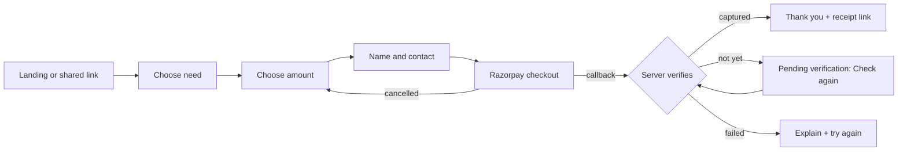
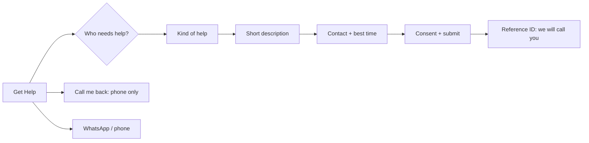

# User journeys

Six journeys the site must support end to end. Each lists the entry points, steps, what the person
sees on success and on failure, and the issues that build it. Routes are in `sitemap.md`; every
English route has a Tamil mirror under `/ta/` (ADR 0004).

Rules that apply to every journey:

- A browser redirect, QR scan, UTR or screenshot is **never** proof of payment. Only a
  server-verified captured payment shows "Thank you — payment received".
- Tamil and English show the same steps, wording and options. Switching language keeps the
  person's progress.
- No personal data in URLs. Every failure screen says what happened and what to do next.

---

## 1. First-time donor

**Goal**: give once, safely, and get an acknowledgement.
**Entry**: landing hero "Donate", a "Ways we help" card (pre-selects the need), a shared link,
the sticky header button.

1. Choose a need, or "General donation" (cards say whether gifts are general or earmarked).
2. Choose an amount: quick picks or a custom amount from ₹1. Optional "cover the processing fee" tick.
3. Enter name and phone or email (kept private; needed for the trust's records). Optional
   "hide my name publicly". When the amount meets the receipt threshold (set by the owner;
   default ₹500) the donor can ask for an acknowledgement — a download link on the result page,
   plus email only if they consent. Tax-benefit opt-in appears only when the trust's approval is
   confirmed.
4. Pay in Razorpay Checkout: UPI QR or app, card, or netbanking.
5. `/donate/status/:token` (a private random link, not the donation reference) shows the
   **verified** result.

| Outcome                       | What the donor sees                                                                                                                    |
| ----------------------------- | -------------------------------------------------------------------------------------------------------------------------------------- |
| Verified paid                 | Thank you, amount, reference; acknowledgement download and share link if the amount meets the threshold; "we've emailed you" if chosen |
| Pending verification          | "Pending verification — we're confirming your payment. Please don't pay again." + **Check again** button; never a false success        |
| Failed                        | "Payment didn't go through." + try again; "If money left your account, contact us with this reference"                                 |
| Cancelled checkout            | Back on the form with the same need and amount filled in                                                                               |
| UPI limit hit                 | Explains bank or new-UPI-user limits; suggests card, netbanking or bank transfer (journey 3)                                           |
| Network drop / refresh / back | Status page re-checks safely; one click never creates a second donation                                                                |

Issues: #12, #23, #24, #26, #27, #29, #30.

---

## 2. Monthly donor (autopay)

**Goal**: give every month and stay in control.
**Entry**: "Give monthly" choice on the amount step, a link in a thank-you email.

1. Choose need and monthly amount.
2. Consent screen: amount, monthly, start date, how to cancel, and (for UPI AutoPay) that the
   bank sends a notice 24 hours before each debit.
3. Authorise the mandate:
   - **Up to ₹15,000/month** → UPI AutoPay (QR or UPI app).
   - **Above ₹15,000/month** → eMandate (netbanking, debit card or Aadhaar) or card. The page
     says that PhonePe and BHIM don't support UPI mandates above ₹15,000.
4. Confirmation page and email with a private **manage link** (`/manage/:token`).
5. Each month: the charge is recorded as its own payment; a receipt is offered per charge
   when it meets the receipt threshold (owner setting, default ₹500), plus an optional yearly summary.

| Outcome                                  | What happens                                                                  |
| ---------------------------------------- | ----------------------------------------------------------------------------- |
| Mandate active                           | Confirmation + manage link                                                    |
| Donor pauses or cancels in their UPI app | Our record follows Razorpay's notice; the manage page shows the new status    |
| Donor cancels via manage link            | Cancelled at Razorpay; confirmation shown and emailed                         |
| A monthly charge fails / mandate halted  | Donor gets a gentle email with a link to restart; owner sees it in exceptions |
| Donor wants a different amount           | Cancel and set up a new mandate (UPI mandates can't be edited)                |

Issues: #32, #33, #29, #30.

---

## 3. Large gift (bank transfer)

**Goal**: give above UPI limits without errors or doubts.
**Entry**: amount above the UPI guidance on `/donate`, the "UPI limit" message, an FAQ link.

1. Choose need and amount; choose **Bank transfer (NEFT/RTGS)**, or card / netbanking for any amount.
2. If Razorpay Smart Collect is enabled for the trust: a unique account number for this donation
   is shown. Otherwise: the trust's bank details and a donation reference to include.
3. Donor transfers from their bank.
4. Smart Collect: the credit is matched automatically → receipt as in journey 1.
   Manual: the donor may add their UTR; the donation stays **pending until the owner confirms it
   against the bank statement**.

| Outcome                               | What happens                                                                      |
| ------------------------------------- | --------------------------------------------------------------------------------- |
| Matched credit                        | Verified paid, receipt, emails                                                    |
| Unmatched or different amount         | Goes to the owner's exceptions queue; donor told "we're confirming your transfer" |
| Donor only uploads a screenshot / UTR | Never marks it paid on its own                                                    |

Issues: #24, #25, #31, #29.

---

## 4. Help seeker (for self or someone else)

**Goal**: ask for help easily, even with low digital confidence.
**Entry**: header and hero "Get Help", the contact section, a shared link to `/ta/help`.

1. Who needs help? **Myself** / **Someone I know** / **I'm helping on behalf of someone**.
2. What kind of help? Large icon cards (education, food & essentials, health, emergency,
   livelihood, other, "I don't know how to explain").
3. Short optional description (Tamil or English). No documents, Aadhaar, medical or income proof.
4. Contact: phone or WhatsApp, preferred language, best time to call. For someone else: the
   helper's contact, plus the person's name or village only if they are comfortable sharing it.
5. Consent and submit: privacy notice, consent for the trust to contact the person, and — when
   asking for someone else — confirmation that the helper believes the person agrees or cannot
   ask for themselves. Clear statement: "Submitting this form does not guarantee help."
6. Result: a reference ID and "we will call you".

**Shortcuts for people who can't fill in a form**: one-field **Call me back** (phone only),
**Chat on WhatsApp** (+91 96005 16999), and the phone number with call hours (Mon–Sat 8 AM – 10 PM).

| Outcome                 | What happens                                                               |
| ----------------------- | -------------------------------------------------------------------------- |
| Submitted               | Reference ID; owner notified; appears as **New** in the inbox              |
| Validation error        | Field-level message in the chosen language; nothing typed is lost          |
| Network error           | "Not sent yet" with retry; WhatsApp and phone offered as alternatives      |
| Spam / repeated submits | Rate limit and honeypot; a real person gets a polite "please wait" message |

Issues: #15, #22, #30.

---

## 5. Family sharer

**Goal**: share the trust with a family or community WhatsApp group, in Tamil.
**Entry**: any page's share action or copied URL.

1. Copy `theonetrust.in/ta/` (or `/ta/donate?programme=…`) and paste it into WhatsApp.
2. The link preview shows the Tamil title, description and image (verified content only).
3. Relatives open it in Tamil, regardless of their own settings, and can switch to English.
4. After donating, a donor can share their **receipt link**; it shows only the minimum
   (trust name, receipt number, date, amount, purpose) — no phone, email, PAN or address.

| Outcome             | What happens                                             |
| ------------------- | -------------------------------------------------------- |
| Tamil link opened   | Tamil page, same section as shared                       |
| Old or wrong link   | Not-found page with a way home, in the link's language   |
| Receipt link shared | Minimal public view; donor's contact details never shown |

Issues: #11, #16, #29.

---

## 6. Trust owner (dashboard)

**Goal**: know what money really arrived, follow up help requests, and keep records, without
database access.
**Entry**: `/admin/login` (password + authenticator app).

Daily: **Overview** (verified today / this month, pending, failed, refunds) → **Exceptions**
(pending too long, mismatches, bank transfers to confirm) → **Help requests** (call New requests,
move status, add private notes) → **Receipts** (resend if an email failed).

Monthly / yearly: **Donations** export (CSV, IST, personal data masked) → **Monthly giving**
health → **Content** and **Transparency** updates (draft → preview in Tamil and English → publish) →
**Tax & compliance**: Form 113 CSV for the financial year, reminder before 31 May.

| Situation                              | What the owner can do                                                                                     |
| -------------------------------------- | --------------------------------------------------------------------------------------------------------- |
| Donor says "I paid but got no receipt" | Search by reference, receipt number or provider ID → see real provider status → resend or explain pending |
| Bank transfer arrived                  | Confirm with bank evidence, a reason and a second confirmation (audited); receipt issued                  |
| Refund needed                          | Record a refund; original record kept; audited                                                            |
| Wrong content published                | Edit and republish; history in the audit log                                                              |
| Lost phone with authenticator          | Recovery codes; every login and change is audited                                                         |

The dashboard never edits donation amounts or payment statuses in place (corrections, refunds and
confirmations are separate audited records). Every change asks for a reason and writes to the audit log.

Issues: #19, #20, #22, #25, #31, #33, #34, #35, #36.
